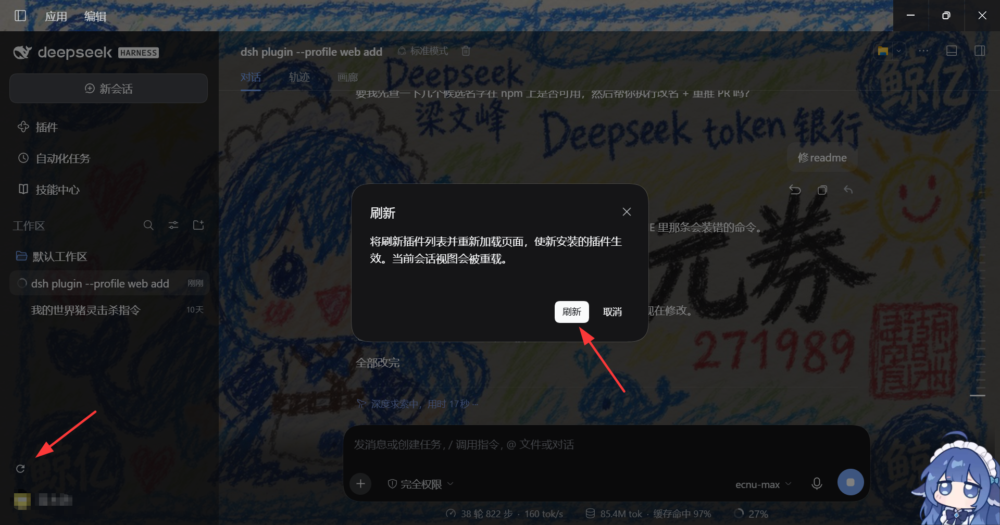

# dsh-refresh

> DSH 桌面插件 · A "刷新" button in the sidebar footer — refresh the plugin inventory and reload the page so newly installed plugins take effect **without restarting the desktop app**.

[](LICENSE)

中文 | [English](#english)

---



> 刷新按钮位于**侧边栏底部操作区**，就在 Settings 按钮旁边（截图中已圈出）。

## 功能简介

`dsh-refresh` 在 DSH 桌面应用的**侧边栏底部操作区**（Settings 按钮旁边）注入一个圆形 **刷新** 图标按钮。点击它：

1. 通过宿主插件管理器的远端接口刷新插件清单（`pluginManager.listBundles()` + `listPlugins()`）；
2. 随后自动重载整个页面（`window.location.reload()`）。

页面重载时，DSH 宿主会按照**当前的** `cordis.patch.yml` / 已激活 bundle 动态重渲 `index.html`（包含最新的 boot manifest），客户端据此重新引导并执行新加入的客户端 bundle —— **使新安装的插件立即生效，全程无需重启桌面应用**。

### 为什么需要它

DSH 桌面应用通过 `cordis.patch.yml` + 已安装 bundle 生成**每次**页面请求的 boot manifest。安装新插件后，客户端需要重新读取这个 manifest 才能真正加载新插件的客户端 bundle —— 过去这往往需要**手动重启整个应用**。

DSH 内部其实已经有这些机制：

- **HMR（热加载）**：`dsh-hmr` / `dsh-client-hmr` 会在插件集合变化时推送新的 bundle graph；
- **内建插件管理器**：自带"刷新"按钮，调 `pluginManager.listBundles()` + `listPlugins()`；
- **bootstrap 替换约束**：`dsh-client-modules` 规定替换 bootstrap module **必须整页刷新**（`window.location.reload()`）。

本插件把"刷新插件清单"和"重载页面"这两件事**合并成一次点击**，并且以**整页重载**兜底：即使插件管理器远端不可用或调用失败，重载本身也会重新读取 boot graph 并加载新 bundle。

## 安装

> ⚠️ **注意包名**：本插件的仓库名是 `dsh-refresh`，但 npm 上的 `dsh-refresh` 属于**另一个插件**（F5 快捷键重载），`dsh-refresh-button` 同样是他人发布的包。请勿执行 `npm i dsh-refresh` / `dsh plugin add dsh-refresh`，那会装到别的插件。本插件目前**未发布到 npm**，请按下面的源码方式安装。

### 方式一：从源码目录（link）安装（推荐）

克隆本仓库后，用本地路径安装：

```bash
dsh plugin --profile desktop add /path/to/dsh-refresh
```

或通过 pnpm 直接 link（会绕过 `dsh plugin` 的 registry 校验）：

```bash
pnpm --dir ~/.dsh/profiles/desktop add "link:/path/to/dsh-refresh" --config.fetch-retries=0
```

> 说明：直接 link 安装后，需要把 `dsh-refresh` 加入 profile 的 `dsh.profile.bundles` 激活清单（`~/.dsh/profiles/desktop/package.json`）。

### 方式二：手动补充到 profile

把 `dsh-refresh` 加入 `dsh.profile.bundles` 数组，并确保它以依赖形式安装到 profile 的 `node_modules`。

## 使用

安装并刷新页面后，侧边栏底部会多出一个圆形 **刷新** 图标按钮：

1. 点击刷新图标；
2. 弹出确认框（防止误触导致页面重载）；
3. 确认后，插件会先刷新插件清单，再在 200ms 后重载页面。

> 说明：对于 DSH 内建插件管理器已支持"应用即生效"的场景，本按钮提供快捷入口；对于经 CLI `dsh plugin add` 安装、或需整页重载才可见的插件，这个按钮就是一次点击的"手动重启替代品"。

## 兼容性

- **DSH**: 0.2.0-rc.2 桌面版（`desktop` profile）
- **平台**: `web`（`dsh.client.platform`）
- **要求**: 客户端需提供 `remote` + `remote.pluginManager` 服务（内建插件管理器所在的环境均有）
- **Node**: >= 20
- **Peer deps**: `@deepseek-ai/cordis ^4.0.2`, `react ^18.2.0`, `react-dom ^18.2.0`

## 目录结构

```text
dsh-refresh/
├── lib/
│   ├── index.js        # Node half（占位，无操作，供 cordis 提供可加载入口）
│   └── client.js       # 全部功能：注入 slots/locale/remote/remote.pluginManager
├── cordis.patch.yml    # bundle 补丁，把插件加入清单
├── package.json        # dsh.client.inject / dsh.bundle.patch 声明
└── README.md
```

## 工作原理

`lib/client.js` 通过 `window.__ModuleLoader__.load({ id, factory })` 注册客户端 bundle，并向 `sidebar.footer.action` 槽位注入刷新按钮。组件通过 `ctx.remote.pluginManager` 刷新插件清单，然后触发 `window.location.reload()`。宿主在每次页面请求时按当前的 boot manifest 重渲 `index.html`，客户端据此重新引导并执行新 bundle。

## License

[MIT](LICENSE)

---

## <a name="english"></a>English


> The refresh button sits in the **sidebar footer**, right next to Settings (highlighted in the screenshot).

`dsh-refresh` is a DSH desktop plugin that adds a **refresh** button to the sidebar footer. Pressing it refreshes the plugin inventory and reloads the page, so **newly installed plugins take effect without restarting the desktop app**.

### Features

- Adds a circular **refresh** icon button to the `sidebar.footer.action` slot (next to Settings).
- Refreshes the plugin inventory via the host plugin-manager remotes (`listBundles()` + `listPlugins()`).
- Reloads the page so the host re-renders the boot manifest with any new client bundles.
- Confirmation dialog prevents accidental page reloads.
- Bilingual UI (中文 / English), auto-selected from the active locale.

### Why

DSH generates a fresh boot manifest for every page request. Installing a plugin only "shows" it to the client after a reload. This plugin makes the built-in HMR + plugin-manager refresh reachable in **one click**, with a full page reload as the safety net.

### Install

> ⚠️ **Package name**: this plugin is **not published to npm**. The npm package `dsh-refresh` belongs to a *different* DSH plugin (F5/Ctrl+F5 keyboard reload), and `dsh-refresh-button` is someone else's package too. Do not run `npm i dsh-refresh` or `dsh plugin add dsh-refresh` — that installs a different plugin. Use the local source install below.

Clone this repository, then install from the local directory:

```bash
dsh plugin --profile desktop add /path/to/dsh-refresh
```

Or link it directly with pnpm (see [安装](#安装) above).

### Compatibility

- DSH 0.2.0-rc.2 desktop (`desktop` profile), `web` platform.
- Requires `remote` + `remote.pluginManager` (present wherever the built-in plugin manager exists).
- Node >= 20; peers: `@deepseek-ai/cordis ^4.0.2`, `react ^18.2.0`, `react-dom ^18.2.0`.

### License

[MIT](LICENSE)